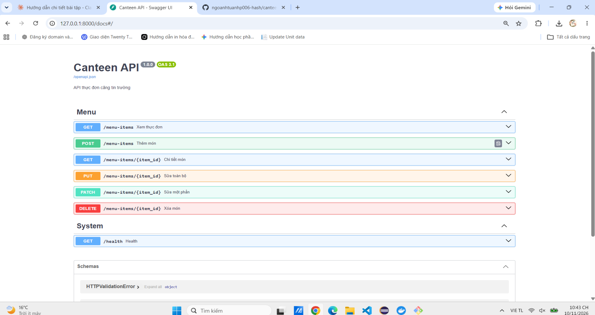

# Canteen API

API thực đơn căng tin trường, xây dựng bằng FastAPI (router – schema – repository), kiểm thử bằng Postman và Newman.

## Cài đặt và chạy
```bash
python3 -m venv .venv
source .venv/bin/activate        # Git Bash trên Windows: source .venv/Scripts/activate
pip install -r requirements.txt
python -m uvicorn app.main:app --reload
```
Mở http://127.0.0.1:8000/docs để xem Swagger.

## Endpoint
| Phương thức | URI | Thành công | Lỗi |
|---|---|---|---|
| GET | /menu-items | 200 | 422 |
| GET | /menu-items/{id} | 200 | 404, 422 |
| POST | /menu-items | 201 + Location | 409, 422 |
| PUT | /menu-items/{id} | 200 | 404, 409, 422 |
| PATCH | /menu-items/{id} | 200 | 404, 409, 422 |
| DELETE | /menu-items/{id} | 204 | 404 |

Chi tiết thiết kế: [docs/design.md](docs/design.md)

## Kiểm thử bằng Postman
Import `postman/Canteen-API.postman_collection.json` và `postman/Canteen-Local.postman_environment.json`, chọn environment **Canteen-Local**, restart server rồi chạy Collection Runner (bỏ thư mục 05-Data-driven).

## Chạy Newman
Restart server trước mỗi lần chạy.
```bash
npx newman run postman/Canteen-API.postman_collection.json \
  -e postman/Canteen-Local.postman_environment.json \
  --folder 01-Read --folder 02-Create --folder 03-Update --folder 04-Delete

npx newman run postman/Canteen-API.postman_collection.json \
  -e postman/Canteen-Local.postman_environment.json \
  --folder 05-Data-driven -d postman/negative.csv
```

## Ảnh minh chứng



